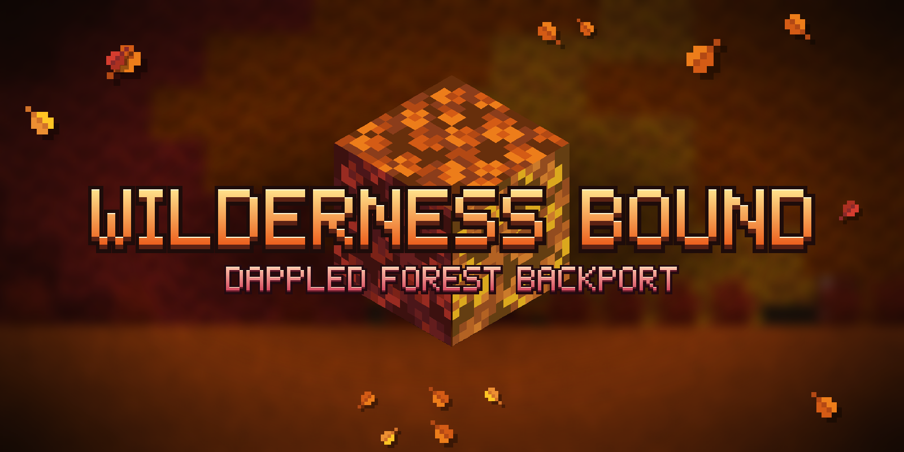

# Wilderness Bound: Dappled Forest Backport

A NeoForge mod that backports the autumn content from **Minecraft 26.3 "Wilderness Bound"** to **1.21.1**: the Dappled Forest biome, poplar wood, cushions, straw beds, shelf mushrooms and abandoned camps.

Everything is registered under vanilla's own IDs (`minecraft:poplar_log`, `minecraft:dappled_forest`, ...), so worlds made with this mod keep their blocks when upgraded to 26.3.

## Features

- **Dappled Forest biome**: orange grass, red/orange/yellow poplar trees, shelf mushrooms, fallen logs, leaf litter, red shrubs and coarse dirt patches
- **Abandoned camps**: tents and campsites with cushions, straw beds and loot
- **Poplar wood set**: logs, wood, planks, stairs, slabs, fences, gates, doors, trapdoors, buttons, pressure plates, signs, hanging signs, boats and chest boats
- **Cushions** (16 colors), **straw beds**, **shelf mushrooms**, **leaf litter**
- **Wool and concrete stairs and slabs** in all 16 colors
- Wandering trader trades for poplar saplings, logs and shelf mushrooms

## Requirements

| | Version |
| --- | --- |
| Minecraft | 1.21.1 |
| NeoForge | 21.1.265 or newer |
| [TerraBlender](https://modrinth.com/mod/terrablender) | 4.1.0.8 or newer (required) |

## Building from source

Requires JDK 21.

```sh
./gradlew build      # the mod jar ends up in build/libs
```

On Windows use `gradlew.bat`, or run the same tasks from IntelliJ's Gradle panel.

## Project layout

| Path | Contents |
| --- | --- |
| `src/main/java/.../block` | Custom blocks: shelf mushroom, red shrub, straw bed, leaf litter, poplar leaves and sapling |
| `src/main/java/.../entity` | The cushion entity and item |
| `src/main/java/.../world` | Poplar tree shapes, tree decorations, fallen trees, the Dappled Forest biome and its TerraBlender region |
| `src/main/java/.../registry` | Block, item, entity and other registrations |
| `src/main/java/.../datagen` | Data generators (run with `runData`) |
| `src/main/resources` | Textures, hand-written models, camp structures and loot tables |
| `src/generated/resources` | Output of `runData`. Don't edit by hand |

## Differences from 26.3

1.21.1 can't do everything 26.3 does, so a few things differ:

- New 26.3 sounds use the closest 1.21.1 sounds
- Fallen trees only generate when the whole log fits (no lone stumps)
- Copper chests, lanterns and copper gear in camps are replaced with 1.21.1 equivalents
- Only the Dappled Forest's camps are included so far
- Placed boats become oak boats when a world is upgraded to 26.3

## License

All rights reserved. See `gradle.properties` (`mod_license`).
